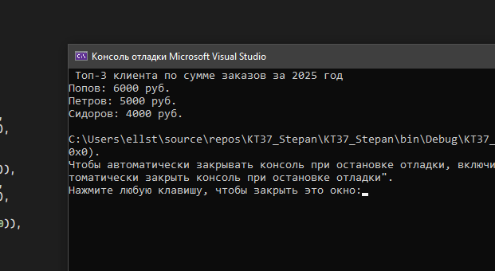

# КТ №37 LINQ-запросы к коллекциям (Вариант 1)

Многошаговый LINQ запрос: фильтрация по дате, группировка по клиенту, подсчет суммы через `Sum()`, сортировка по убыванию и выборка топ-3 через `Take(3)`.

Задание:

Проверочные ключи:

Результат работы (вывод в консоль):
